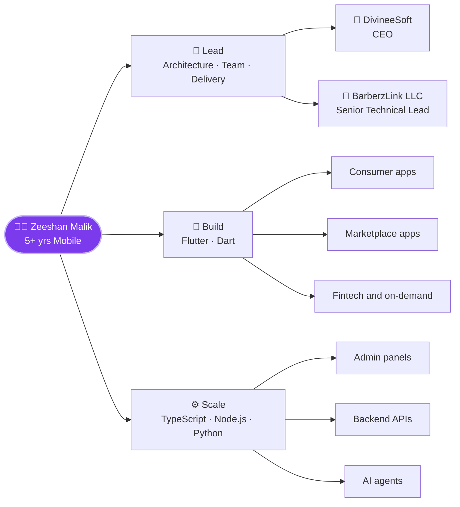

<!--
  Zeeshan Malik · zeemalik-dev
  HOW TO USE: create a PUBLIC repo named exactly  zeemalik-dev/zeemalik-dev
  and put this file in it as README.md. GitHub shows it on your profile.
-->

 

---

## 👋 About Me

I'm a **mobile-first engineer and founder** with **5+ years of experience** designing, building and shipping apps for real users and real businesses.

Today I'm the **CEO of DivineeSoft Technologies** and the **International Partner & Senior Technical Lead at BarberzLink LLC**. I lead architecture and delivery, and I still write production code every week. That means when you work with me, you get a leader who understands the code and an engineer who understands the business.

> **My promise:** you get a product that is fast, clean, scalable, and delivered on time. Not a prototype that falls apart after launch.

---

## 🎯 Why Work With Me

| | What you get | Why it matters |
|:---:|:---|:---|
| 📱 | **5+ years of mobile experience** across Flutter, Dart and cross-platform delivery | I have already solved the problems your project will run into |
| 🚀 | **Idea → MVP → production** under one roof | One accountable person, no hand-off gaps |
| 🧭 | **Architecture-first thinking** | Your app is built to grow, not rebuilt at 10,000 users |
| 🤖 | **AI integrated where it genuinely helps** | Smarter features without the hype |
| 🌍 | **International client experience** | Clear communication across time zones and cultures |
| 🏢 | **I run a company, so I think like an owner** | I care about your outcome, deadlines and budget |
| 🔁 | **Full-stack range** | Mobile, web, admin panels and backend APIs, all connected |

---

## 📱 Mobile App Expertise

| 🎨 **Product-grade UI** | 🧱 **Clean Architecture** | 🔌 **Integrations** |
|:---|:---|:---|
| Pixel-accurate Flutter UI from Figma, responsive across phones and tablets | Scalable structure, state management, maintainable and testable code | REST APIs, Firebase, maps and live tracking, wallets and payments flows, push notifications |

| 🚢 **Release & Delivery** | 🤖 **AI-powered Features** | 🧑‍🤝‍🧑 **Multi-role Apps** |
|:---|:---|:---|
| Android and iOS builds, store-ready packaging, ongoing updates | AI assistants, voice agents and smart content generation inside apps | Customer, provider, admin and staff roles in one ecosystem |

---

## 🧬 How My Work Fits Together

---

## 🚀 Featured Products

### 🏆 Flagship work

| Product | What it does | Stack | Access |
|:---|:---|:---|:---:|
| **BarberzLink / BarberzHub** | Multi-platform barber and beauty ecosystem: mobile apps, web, hub and admin panel. I lead the technical direction. | Flutter · TypeScript | 🔒 Private |
| **Cosmolink** | Beauty app for women with mobile app, web app, backend and admin panel. Live at [cosmolynk.com](https://cosmolynk.com) | Flutter · TypeScript | 🔒 Private |
| **[PetroQwiq](https://github.com/zeemalik-dev/PetroQwiq-Client-App)** | On-demand fuel delivery: choose fuel and quantity, track the tanker live on a map, manage a virtual fuel tank balance | Flutter · Dart | 🌍 Public |
| **[KuTaGjej](https://github.com/zeemalik-dev/KuTaGjej-Albanian-Mobile-App)** | Albanian classifieds and services platform on web and mobile | Flutter · Dart | 🌍 Public |
| **[Escroc](https://github.com/zeemalik-dev/Escroc-Mobile-App)** | Escrow transactions app: create and track deals, chat about a transaction, wallet activity | Flutter · Dart | 🌍 Public |
| **[AI Dispatch](https://github.com/zeemalik-dev/AI-Dispatching-App)** | AI voice assistants plus day-to-day service operations: dashboard, conversations, customer inquiries | Dart · AI | 🌍 Public |
| **[WILAN Learn](https://github.com/zeemalik-dev/Online-Courses-App)** | Leadership and professional development courses in your pocket | Flutter · Dart | 🌍 Public |

### 🧩 More from my lab

| Product | What it does | Stack |
|:---|:---|:---|
| **[OneSec](https://github.com/zeemalik-dev/ONESEC)** | Improves interaction between companies, individuals and employees | Flutter · Dart |
| **[DivineeSoft HRM](https://github.com/zeemalik-dev/DivineeSoft-HRM)** | Human resource management system | TypeScript |
| **[DivineeSoft AI Agent](https://github.com/zeemalik-dev/DivineeSoft-AI-Agent)** | AI agent for real business workflows | Python |
| **[Smart POS Cloud](https://github.com/zeemalik-dev/smart-pos-cloud)** | Cloud-based point-of-sale system | Cloud |
| **[Bus Tracking System](https://github.com/zeemalik-dev/Frontent-Bus-Tracking-System)** | Flutter UI for Admin, Teacher and Student roles | Flutter · Dart |
| **[NFC Mobile App](https://github.com/zeemalik-dev/NFC-Mobile-App)** | Built from scratch in 2024 with a Karachi company and delivered successfully | JavaScript |
| **[Spot Brighton](https://github.com/zeemalik-dev/Spot-Brighton-App-FlutterFlow)** | Event management app: browse events, manage tickets, save favorites, explore venues and promoters | FlutterFlow · Firebase |

<b>📂 Even more public repositories (click to expand)</b>

 

| Repository | Description |
|:---|:---|
| [BloodLines](https://github.com/zeemalik-dev/BloodLines) | Pet app with ancestor tracking and a community to show off pets |
| [Soccer-Sphere-Insights](https://github.com/zeemalik-dev/Soccer-Sphere-Insights) | Real-time soccer analysis: live matches, player and team stats |
| [Money-Manager-App](https://github.com/zeemalik-dev/Money-Manager-App) | Personal finance app on Firebase |
| [Kitty-Expense-App](https://github.com/zeemalik-dev/Kitty-Expense-App) | Expense manager built to sharpen Flutter skills |
| [fec_school](https://github.com/zeemalik-dev/fec_school) | School management cycle app |
| [ambulance_qr_scanner](https://github.com/zeemalik-dev/ambulance_qr_scanner) | QR and barcode scanner with ambulance tracking idea |
| [learn_arabic](https://github.com/zeemalik-dev/learn_arabic) | Learn Arabic into English |
| [AceTime-AI-FaceTime](https://github.com/zeemalik-dev/AceTime-AI-FaceTime) | AI meeting assistant concept with face recognition and voice commands |
| [DivineeSoft-Technology](https://github.com/zeemalik-dev/DivineeSoft-Technology) | Company platform |

---

## 🛠️ Tech Stack

**Mobile**

**Web & Backend**

**Tools & Cloud**

---

## 🤝 How I Work With Clients

| 1️⃣ Discover | 2️⃣ Design | 3️⃣ Build | 4️⃣ Launch | 5️⃣ Grow |
|:---:|:---:|:---:|:---:|:---:|
| Understand your users, goals and constraints | Architecture, UX flows and a clear roadmap | Focused sprints with demos you can see and test | Store-ready release and smooth rollout | Monitor, improve and scale with you |

**Working style:** transparent communication, honest timelines, regular progress updates, and code you can own and extend.

---

## 💼 Let's Work Together

I'm open to:

- 📱 **Mobile app development** (Flutter, iOS and Android)
- 🏗️ **MVPs and full product builds** for startups and businesses
- 🤖 **AI feature integration** into existing apps
- 🧭 **Technical leadership**: architecture reviews, team direction, delivery rescue
- 🤝 **Long-term partnerships**

**Have an idea, a team to strengthen, or an app that needs to scale?**

---

## 📊 GitHub Activity

<picture>
  <source media="(prefers-color-scheme: dark)" srcset="https://raw.githubusercontent.com/zeemalik-dev/zeemalik-dev/output/github-snake-dark.svg" />
  <source media="(prefers-color-scheme: light)" srcset="https://raw.githubusercontent.com/zeemalik-dev/zeemalik-dev/output/github-snake.svg" />
  
</picture>

 

*"Great apps aren't just coded. They're engineered, shipped and cared for."*

