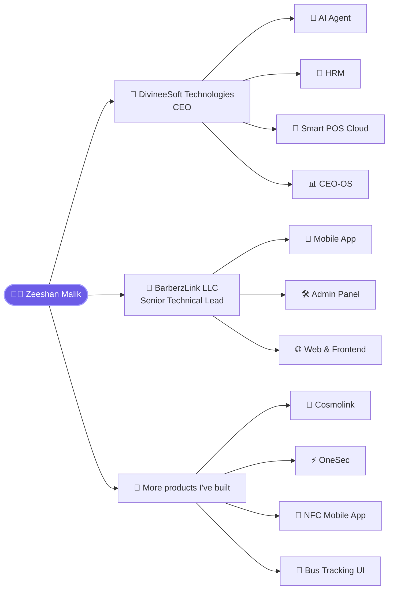

<!--
  Zeeshan Malik · zeemalik-dev
  HOW TO USE: create a PUBLIC repo named exactly  zeemalik-dev/zeemalik-dev
  and put this file in it as README.md. GitHub shows it on your profile.
-->

<div align="center">


<a href="https://divineesoft.com">
  
</a>

<br/>

[](https://divineesoft.com)
[](https://md-zeeshan-aslam.vercel.app/)
[](https://www.linkedin.com/in/zeeshan-malik-0749a7252/)
[](https://www.linkedin.com/company/divineesoft-technologies/)


</div>

---

## 👋 Hey, I'm Zeeshan

I run **DivineeSoft Technologies** and serve as **International Partner & Senior Technical Lead at BarberzLink LLC**. I turn ideas into production-grade **AI, SaaS, mobile and web products**, and I stay hands-on in the code while leading the team.

```js
const zeeshan = {
  name: "Zeeshan Malik",
  handle: "@zeemalik-dev",
  location: "Lahore, Pakistan 🇵🇰",
  roles: [
    "CEO @ DivineeSoft Technologies",
    "International Partner & Senior Technical Lead @ BarberzLink LLC",
  ],
  expertise: ["AI", "SaaS", "Mobile Apps", "Web Platforms"],
  stack: ["Flutter", "TypeScript", "Node.js", "Python"],
  mindset: "Ship fast. Build it right. Make it scale.",
  openTo: ["Client projects", "Partnerships", "Great engineering conversations"],

  contact() {
    return "Let's build something remarkable → divineesoft.com";
  },
};
```

---

## 🛠️ What I Build

| 🤖 **AI Solutions** | ☁️ **SaaS Platforms** | 📱 **Mobile Apps** |
|:---|:---|:---|
| AI agents and automation that take real work off your team's plate | HRM, cloud POS, admin and executive dashboards | Cross-platform Flutter apps for iOS & Android |

| 🌐 **Web Applications** | ⚙️ **Backend & APIs** | 🧭 **Technical Leadership** |
|:---|:---|:---|
| Fast, modern TypeScript frontends and admin panels | Clean, scalable services that power the apps above | Architecture, team direction and delivery from day one to launch |

---

## 🧬 My Ecosystem



---

## 🚀 Featured Work

| Product | What it is | Built with | Access |
|:---|:---|:---|:---:|
| **BarberzLink** | Multi-platform product: mobile app, web app, admin panel and hub. I lead the technical direction. | Flutter · TypeScript | 🔒 Private |
| **Cosmolink** | Beauty app for women, with mobile app, web app, backend and admin panel. Live at [cosmolynk.com](https://cosmolynk.com) | Flutter · TypeScript | 🔒 Private |
| **[OneSec](https://github.com/zeemalik-dev/ONESEC)** | Mobile app that improves interaction between companies, individuals and employees | Flutter · Dart | 🌍 Public |
| **[DivineeSoft HRM](https://github.com/zeemalik-dev/DivineeSoft-HRM)** | Human resource management system | TypeScript | 🌍 Public |
| **[DivineeSoft AI Agent](https://github.com/zeemalik-dev/DivineeSoft-AI-Agent)** | AI agent built for real business workflows | Python | 🌍 Public |
| **[Smart POS Cloud](https://github.com/zeemalik-dev/smart-pos-cloud)** | Cloud-based point-of-sale system | Cloud | 🌍 Public |
| **[Bus Tracking System](https://github.com/zeemalik-dev/Frontent-Bus-Tracking-System)** | Polished Flutter UI for Admin, Teacher and Student roles | Flutter · Dart | 🌍 Public |
| **[NFC Mobile App](https://github.com/zeemalik-dev/NFC-Mobile-App)** | Built from scratch in 2024 with a Karachi company and delivered successfully | JavaScript | 🌍 Public |

<details>
<summary><b>📂 More public repositories (click to expand)</b></summary>

<br/>

| Repository | Description |
|:---|:---|
| [DivineeSoft-Technology](https://github.com/zeemalik-dev/DivineeSoft-Technology) | Company platform, TypeScript |
| [ironman-backend](https://github.com/zeemalik-dev/ironman-backend) | Backend service, JavaScript |
| [fec_school](https://github.com/zeemalik-dev/fec_school) | School management cycle app, Flutter |
| [AceTime-AI-FaceTime](https://github.com/zeemalik-dev/AceTime-AI-FaceTime) | AI-powered meeting assistant concept with face recognition and voice commands |
| [learn_arabic](https://github.com/zeemalik-dev/learn_arabic) | Learn Arabic into English, Flutter |
| [autism-support](https://github.com/zeemalik-dev/autism-support) | Support app, Flutter |
| [all-care-finances](https://github.com/zeemalik-dev/all-care-finances) | Finance platform, TypeScript |
| [portfolioWebsite](https://github.com/zeemalik-dev/portfolioWebsite) | Personal portfolio, HTML |

</details>

---

## ⚡ Tech Stack

<div align="center">


</div>

---

## 📊 GitHub Analytics

<div align="center">


</div>

### 🐍 Contribution Snake

<div align="center">

<picture>
  <source media="(prefers-color-scheme: dark)" srcset="https://raw.githubusercontent.com/zeemalik-dev/zeemalik-dev/output/github-snake-dark.svg" />
  <source media="(prefers-color-scheme: light)" srcset="https://raw.githubusercontent.com/zeemalik-dev/zeemalik-dev/output/github-snake.svg" />
  
</picture>

</div>

---

## 🤝 How I Work With Clients

| 1️⃣ Discover | 2️⃣ Design | 3️⃣ Build | 4️⃣ Launch | 5️⃣ Scale |
|:---:|:---:|:---:|:---:|:---:|
| Understand the problem and the business | Plan architecture and UX | Ship in focused iterations | Deploy with confidence | Improve, monitor and grow |

---

## 📬 Let's Build Something Great

<div align="center">

**Have a product idea, a team to strengthen, or a system to scale?**

[](https://divineesoft.com)
[](https://www.linkedin.com/in/zeeshan-malik-0749a7252/)

<br/>

*"Great software isn't written, it's engineered, shipped and cared for."*


</div>
